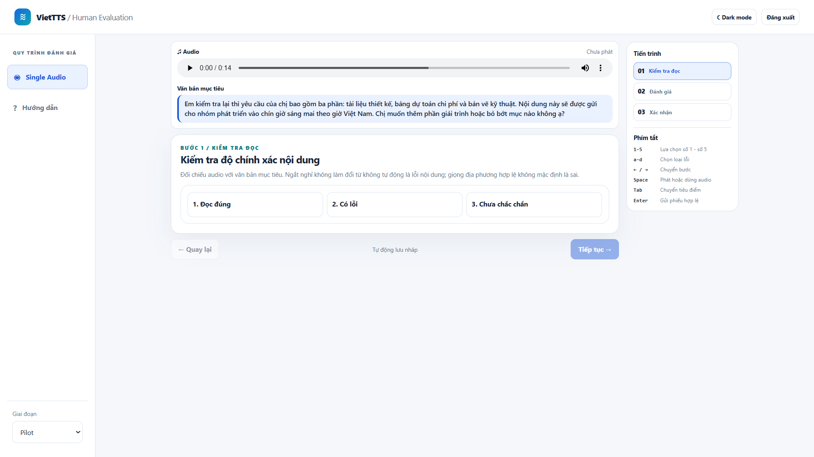
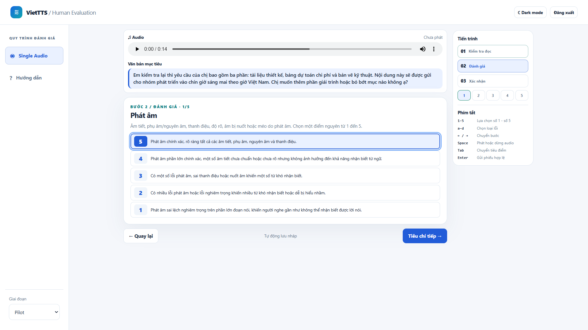
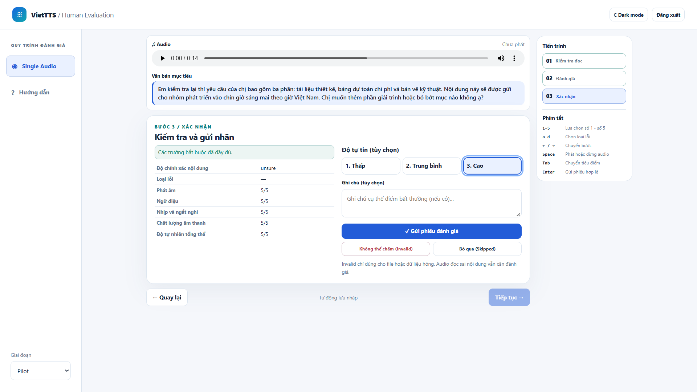

# VietTTS — Đánh giá TTS tiếng Việt

| Đăng nhập | Bước 1: Kiểm tra đọc |
| --- | --- |
|  |  |

| Bước 2: Đánh giá theo từng tiêu chí | Bước 3: Xác nhận và gửi nhãn |
| --- | --- |
|  |  |

Ứng dụng nội bộ để **người thật đánh giá từng audio tiếng Việt**. Mỗi phiếu Single Audio có một trạng thái chính xác nội dung, loại lỗi khi cần, **năm điểm chất lượng độc lập từ 1 đến 5**, cùng độ tự tin và ghi chú tùy chọn. Giao diện sáng là mặc định. Kho mã không chứa audio hoặc nhãn giả lập.

Ứng dụng dùng Python chuẩn (không cần `pip`), SQLite và trình duyệt. Dữ liệu nghiên cứu nằm trong thư mục `data/` ngoài Git.

## Khởi động

Cần Python **3.10 trở lên** và thư mục dự án có quyền ghi.

| Hệ điều hành | Chỉ máy hiện tại | Mạng nội bộ tin cậy |
| --- | --- | --- |
| Windows | `start_windows.bat` | `start_windows_lan.bat` |
| Linux | `./start_local.sh` | `./start_lan.sh` |
| macOS | `./start_local.sh` hoặc `start_macos.command` | `./start_lan.sh` hoặc `start_macos_lan.command` |

Trên Linux/macOS, có thể dùng `sh start_local.sh` hoặc `sh start_lan.sh` nếu file mất quyền chạy khi giải nén ZIP. Windows hỗ trợ cả `python` và `py -3`. Thêm `--port PORT` nếu muốn đổi cổng. Lần đầu chạy, lưu mật khẩu `admin` in trên terminal, mở **http://localhost:8765** rồi đăng nhập. Có thể đặt trước biến môi trường `TTS_ADMIN_PASSWORD` (ít nhất 8 ký tự) trước lần chạy đầu tiên.

Với chế độ LAN, chia sẻ `http://<IP-máy-chủ>:8765` cho người đánh giá trên cùng mạng tin cậy. Chỉ cho phép cổng này qua firewall của mạng nội bộ. Máy chủ HTTP này **không dành cho Internet công cộng**.

## Hướng dẫn theo vai trò

Trang **Hướng dẫn** trong ứng dụng tự hiển thị nội dung phù hợp với quyền tài khoản.

**Quản trị viên:** trong **Bộ dữ liệu**, tải audio thật, nhập `sample_id` duy nhất và transcript đúng nguyên văn, chọn `pilot` hoặc `main`, thêm chỉ dẫn phong cách và metadata riêng tư nếu có. Audio tham chiếu có thể được lưu trong bản ghi nguồn nhưng không hiển thị ở màn chấm. Dùng [manifest_template.json](manifest_template.json) hoặc nút **Tải khung manifest chuẩn** để chuẩn bị nhiều sample; manifest không nhận Pairwise. Trong **Tài khoản**, tạo tài khoản riêng cho từng evaluator; mục tiêu mặc định là **ba phiếu hoàn thành từ ba tài khoản khác nhau cho mỗi sample**. Trong **Kiểm soát nhãn**, xem số phiếu, độ chính xác nội dung, phân bố và độ chênh năm điểm theo giai đoạn. Trong **Xuất dữ liệu**, tải phiếu Single Audio dạng JSONL/CSV và metadata sample dạng JSONL.

**Người đánh giá:** chọn đúng giai đoạn Pilot hoặc Chính thức. Văn bản mục tiêu và audio luôn ở đầu phiếu; tiến trình ba bước, năm bước nhỏ và phím tắt nằm trong panel bên phải trên màn hình rộng. Chỉ dẫn phong cách trong metadata nguồn không xuất hiện trên màn chấm. Quy trình có ba bước: **Kiểm tra đọc**; **Đánh giá** qua năm bước nhỏ, mỗi bước một tiêu chí; **Xác nhận** rồi gửi. Mỗi tiêu chí có năm hàng điểm theo thứ tự 5 đến 1, kèm mô tả đầy đủ của từng mức. Nháp được lưu tự động. Phiếu đã gửi không thể tự sửa. Người đánh giá không thấy metadata riêng tư hoặc phiếu của người khác.

Phím tắt trong phiếu: `1/2/3` chọn trạng thái đọc; sau khi chọn Có lỗi, `a/b/c/d` bật hoặc tắt bốn loại lỗi. Trong từng bước nhỏ, `1–5` chọn điểm. Ở bước Xác nhận, `1/2/3` chọn độ tự tin Thấp/Trung bình/Cao; `Enter` gửi phiếu khi toàn bộ trường bắt buộc đã đủ. `←/→` chuyển giữa các bước khi trường bắt buộc đã đủ; sau khi gửi, `→` mở mẫu tiếp theo. `Space` phát hoặc dừng audio ngoài ô nhập và trình phát. `Tab` chuyển tiêu điểm. Trong ô nhập và trên các nút hành động khác, `Enter` giữ hành vi thông thường. Di chuột hoặc đặt tiêu điểm lên loại lỗi để xem giải thích.

## Nhãn Single Audio

`text_accuracy` nhận một trong `no_error`, `has_error`, `unsure`. Nếu chọn `has_error`, chọn ít nhất một `error_types`: `omission`, `insertion`, `substitution`, `repetition`.

| Trường điểm | Tiêu chí | Xem xét |
| --- | --- | --- |
| `pronunciation` | Phát âm | Âm tiết, phụ âm/nguyên âm, thanh điệu, độ rõ, âm bị nuốt/méo. |
| `intonation` | Ngữ điệu | Lên/xuống giọng, nhấn ngữ nghĩa và sự phù hợp với loại câu. |
| `pacing` | Nhịp và ngắt nghỉ | Tốc độ, nhịp, khoảng nghỉ, tính liền mạch và chỗ ngắt. |
| `audio_quality` | Chất lượng âm thanh | Rè, nhiễu, méo, clipping, glitch, đứt đoạn và artifact. |
| `naturalness` | Độ tự nhiên tổng thể | Mức độ giống cách người thật nói trong ngữ cảnh, xét độc lập. |

Thang điểm: **1 Rất kém** (lỗi nghiêm trọng), **2 Kém** (nhiều lỗi rõ), **3 Trung bình** (có lỗi nhận ra), **4 Tốt** (chỉ lỗi nhỏ), **5 Rất tốt** (gần như không có lỗi đáng kể). Trang Hướng dẫn và màn chấm điểm có mô tả chi tiết cho cả năm mức của từng tiêu chí. `naturalness` được chọn độc lập, **không tính trung bình bốn điểm khác**. Giọng trung tính phù hợp ngữ cảnh không tự động bị trừ điểm tự nhiên.

`confidence` (`low`/`medium`/`high`) và `note` là tùy chọn. `invalid` dành cho file hoặc dữ liệu hỏng khiến không thể đánh giá; `skipped` dành cho trường hợp bỏ qua. Cả hai cần lý do và không được tính là phiếu hoàn thành. Audio đọc sai nội dung vẫn được chấm `has_error`, không tự động là `invalid`.

## Dữ liệu, xuất và sao lưu

Thư mục `data/` gồm `annotations.db`, `media/` và `.server_secret`. Sao lưu **cả thư mục** khi máy chủ đã dừng. Repository và GitHub không chứa thư mục này; sao chép repository sang máy khác sẽ bắt đầu với bộ dữ liệu trống. Khi chuyển nghiên cứu, chuyển cả thư mục `data/` qua kênh tin cậy.

Mỗi phiếu xuất giữ `sample_id`, username, giai đoạn, trạng thái, nhãn nội dung, năm điểm, confidence, note và mốc thời gian. CSV có cột ổn định kể cả khi chưa có phiếu. File JSONL/CSV không chứa binary audio. Manifest nhập mẫu chỉ gồm trường `samples`; mỗi sample yêu cầu `sample_id`, `target_text`, `audio_url` (file `/media/...` đã upload hoặc HTTPS); có thể thêm `phase`, `style_instruction`, `reference_audio_url`, `private_metadata`. Nhập một manifest là giao dịch nguyên tử. File audio nhận `.wav`, `.mp3`, `.m4a`, `.ogg`, `.webm`, `.flac`, `.aac`, `.opus` tối đa 60 MB; manifest JSON tối đa 4 MB mỗi yêu cầu. Việc kiểm tra header không thay thế kiểm tra audio thực sự phát được; trình duyệt có thể hỗ trợ codec khác nhau.

Khung manifest chứa một object sample với toàn bộ tên trường được hỗ trợ và giá trị trống. Điền `sample_id` duy nhất (tối đa 100 ký tự, chỉ gồm chữ/số và `.`, `_`, `:`, `-`), `target_text` đúng nguyên văn, `audio_url` có thật và `phase` là `pilot` hoặc `main`, rồi nhân bản object nếu cần thêm sample. Có thể để trống `style_instruction`, `reference_audio_url` và `private_metadata`; nếu có audio tham chiếu, URL cũng phải là `/media/...` đã upload hoặc HTTPS. Khung chưa điền sẽ bị từ chối khi import; nó không tạo dữ liệu giả trong hệ thống.

## Kiểm tra phần mềm và giới hạn

Chạy `python -B -m unittest discover -s tests -v` trên Windows hoặc `python3 -B -m unittest discover -s tests -v` trên Linux/macOS. Bộ kiểm tra tương tác giao diện dùng Node.js chuẩn: `node tests/test_ui_shortcuts.js`; Node.js chỉ cần cho kiểm thử, không cần để chạy ứng dụng. GitHub Actions chạy cả hai trên ba hệ điều hành. Các thống kê QC mang tính mô tả; ứng dụng không tự tạo nhãn đúng cuối cùng hoặc xác nhận chất lượng nghiên cứu. Cần pilot thật với người đánh giá thật để đánh giá độ tin cậy.

Ứng dụng chỉ dành cho máy dự án hoặc LAN tin cậy. Nó không có TLS/HTTPS, khôi phục mật khẩu, khóa tài khoản hoặc các biện pháp bảo vệ cần thiết cho triển khai công khai. Nếu quên mật khẩu admin, không nên chỉnh SQLite thủ công. Đóng terminal sẽ dừng server; khởi động lại bằng launcher để tiếp tục với dữ liệu đã lưu.
